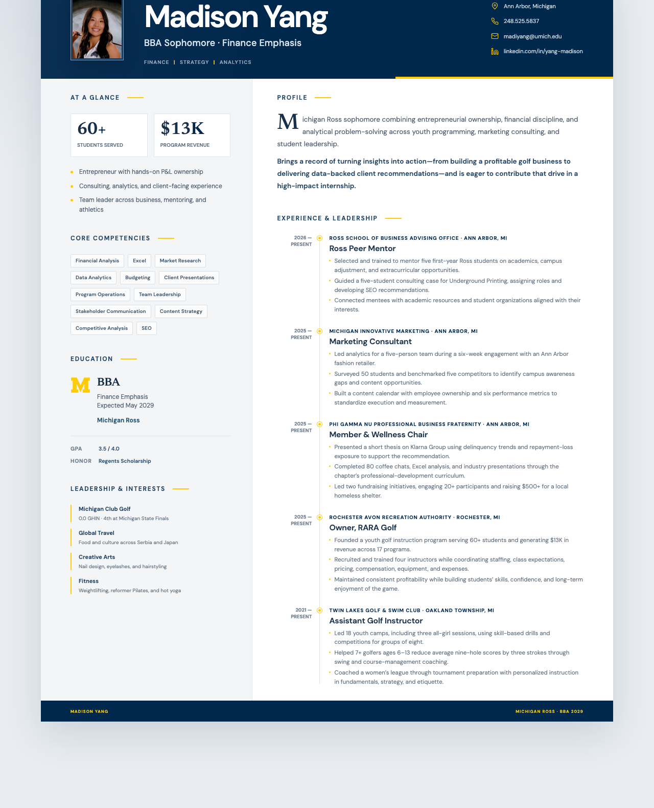

# Madison Yang – CV

**Live site: https://madiyang.github.io/cv/**

[](https://madiyang.github.io/cv/)

A single-page CV built with React, Tailwind CSS and Vite (generated with Figma Make). The page can be exported to Word or printed / saved as PDF using the buttons at the top right.

## Development

```bash
ln -s figma .figma   # vite.config.ts imports ./.figma/make/site.json
npm install
npm run dev          # http://localhost:8443
npm run build        # outputs to dist/
```

## Deployment

Pushes to `main` are built and deployed to GitHub Pages by
[`.github/workflows/pages.yml`](.github/workflows/pages.yml). The build sets
`FIGMA_PUBLIC_URL=/cv` so assets resolve under `/cv/`.
